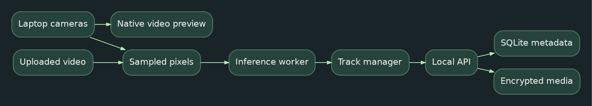
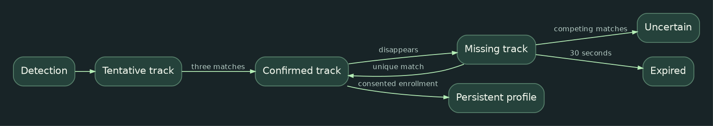
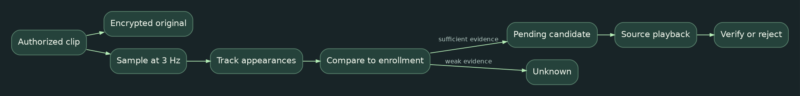
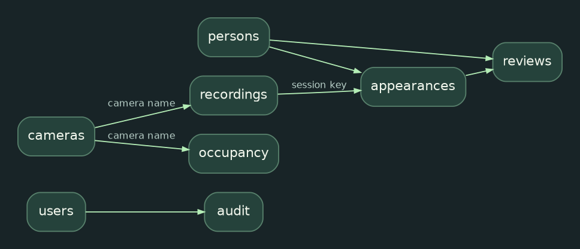

# Person analytics engineering notes

## Purpose and scope

A reviewer in a consented lab session needs to find a participant in a second recording and inspect the original footage. ARGUS-X assigns temporary track IDs during observation, stores an enrolled profile when authorized, and proposes cross-source matches. The ordinary review workflow links manually. The opt-in entry-photo workflow can restore a strong, distinct match automatically. A participant outside the camera view has no known current location.

## Existing code and implementation sequence

The original application contains three static workspaces, a shared JavaScript tracker, bundled TensorFlow.js and COCO-SSD weights, and a Python static server. No pre-existing SQL schema or Flask/YOLO backend was supplied. The earlier webcam finder drew the whole scene after inference. The revised finder layers its boxes over native video. The new analytics workspace runs inference in a worker.

1. Reused the detector assets, shared tracking cost and assignment code.
2. Added a loopback service, accounts, local schema, retention and protected media.
3. Added a worker, per-source tracking, clothing analysis, feature extraction and bounded capture.
4. Added enrollment, candidate review, optional one-to-one face comparison and recording search.
5. Connected the twelve views, alerts, health measurements, reports and presentation materials.

## System architecture

The browser owns media capture and playback. The Python 3 service owns authentication, authorization, similarity scoring, confirmations and storage. Windows uses SQLite and the current Windows account's DPAPI. Other platforms use AES-GCM through Python's cryptography package and a local key with owner-only permissions. The ordinary database contains typed event and operational metadata. The encrypted person payload holds the image, body descriptors and optional face vector. Video bytes live in encrypted files outside the web root. Only an authenticated endpoint decrypts a recording for playback. Operating-system backups need their own access controls and retention policy.

## Detection, attributes and tracking

The detector samples a 480 × 270 letterboxed image and emits person boxes with model-class scores. A second pass pools a 576-dimensional MobileNetV2 activation over the person's region. This is a generic pretrained visual representation. Regional color histograms sample the central torso and lower-body regions. A gradient orientation histogram adds a texture cue. The app reports color estimates even when clothing boundaries are ambiguous. A backpack, handbag or tie overlapping the box can appear as an accessory hint. Occluded shoes, eyewear, hats and garment category have no dedicated classifier.

Per-source Hungarian assignment uses class, expected motion, size and appearance. Three matches confirm a box. Similar competing candidates can be withheld. A 30-second in-memory track horizon handles short absences. Enrolled database profiles survive restart and have a separate numeric sequence. In opt-in entry-photo mode, a new confirmed arrival with no plausible match is enrolled under the recorded participant authorization. Temporary track numbers are meaningful only alongside the session UUID.

## Persistent matching and review

The body search compares a unit-normalized learned descriptor using cosine similarity and three normalized histograms using intersection. The cosine gate is 0.76. A weighted score uses 70% cosine and 30% histogram intersection. A score of 0.80 opens a review candidate. These are engineering thresholds, not population-calibrated probabilities. The system presents qualifying candidates and allows rejection. Strong similarity alone does not establish identity. Upload results can open the indexed source at the appearance offset. When a verified reference recording exists, its segment is also available. Appearance times for uploads use indexing time plus clip offset; the original wall-clock capture time is unknown.

Consent-based face processing is independent of body search. An administrator confirms separate face consent for the selected person crop. The bundled face-api.js tiny detector, landmarks and recognition model require exactly one detectable face. An enrolled reference has a 128-value descriptor. Later a participant can authorize comparison to one selected enrolled profile. A distance below 0.48 is evidence of consistency. The software never searches an unknown face against a gallery. The current comparison probe is processed in memory. Consent is recorded by operator attestation, without an external consent-signature service.

## Storage

Schema lives in tools/storage.py. persons stores durable enrollments; appearances stores a unique row per session and confirmed track; reviews links candidate profiles to an appearance. recordings and appearances share a session UUID. Deleting a clip deletes its indexed appearances. Deleting a profile destroys its encrypted reference, cascades reviews and unlinks historical appearance rows. Deleting a profile leaves the original source videos under their own retention policy. cameras holds zone configuration; occupancy aggregates per-hour, per-camera 8 × 5 spatial bins. audit stores sign-in, enrollment, decisions, alerts and administration. Foreign keys protect person and review links. Unique constraints prevent repeat requests from duplicating a track event. The starter creates missing tables and indexes additively.

## API surface

All routes are under /api. Reads require a session except status. Mutations require same-origin requests. Viewer accounts can inspect authorized records, reports and recordings. Administrator role is checked on the server for processing, enrollment, export of new media to the vault, access changes and deletion.

| Route | Method | Purpose |
|---|---|---|
| status, setup, login, logout | GET status, POST others | Bootstrap token, hashed password login, session lifecycle |
| state, health | GET | Enrollments, events, candidates, settings and bounded audit history; local host metrics |
| events, occupancy | POST | Idempotently index track and create similarity candidates; aggregate sampled locations |
| enroll, verify, face-check, search-image | POST | Consent-gated enrollment, human review, one-to-one face check and authorized reference search |
| media | POST | Container signature and size check, encrypted WebM/MP4 storage and metadata |
| media/{id} | GET | Authenticated playback bytes |
| delete-person, delete-recording | POST | Delete enrollment data or an original recording and its linked events |
| camera, settings, user, alert | POST | Camera configuration, retention, account creation and event audit |

Example event body fields are session UUID, track, camera, at, offset, upper, lower, score, x, y, descriptor[48], embedding[576]. Positions are normalized in the letterboxed inference frame. Responses contain an ID or an error with an HTTP status. The service binds only to loopback. Password hashes use salted PBKDF2; session cookies are HttpOnly and SameSite=Strict with an eight-hour lifetime. Setup requires the launcher's private token. Access to the Windows user account and local files remains part of the trust boundary. An authorized viewer can always capture what they are permitted to view.

## Performance, limits and operations

The video element plays at the camera's delivered rate. A separate worker performs detection and feature extraction. Each active source submits one frame, waits for a result, and then samples the newest one. Up to three sources share a serialized worker; no unbounded capture queue accumulates. Live display FPS uses the browser's presented-frame counter. Inference time and sample-to-result delay are measured independently. The app reports unavailable fields explicitly. Host CPU and RAM come from Windows or Linux counters; GPU utilization has no portable reading. The packaged analytics worker uses WASM or CPU. Capture-to-display latency cannot be inferred from the detector timer alone.

Optional recording saves one authorized session up to 60 seconds or the size guard. Stop the source and wait for confirmation before closing the tab. Unfinished in-memory recordings can be lost on a crash. Uploads are limited to 32 MiB and indexed at three timestamps per second; brief appearances may be missed. Uploaded source footage remains available if indexing is stopped early. Occupancy bins sample tracked centers once per observed media second; sparse inference undercounts time in view. Zones use normalized coordinates in the preview. Occupancy thresholds, zone entry, a verified watch profile, camera errors and disconnects produce rule-based alerts. This is not a learned unusual-behavior classifier.

The operational limits suit a single-laptop demonstration. Future work includes a dedicated person Re-ID model with a labeled benchmark, continuous rolling recording, larger-gallery indexing, calibrated similarity scores, a separate production identity provider, hardware acceleration profiling, and site-specific data-governance review. Generic learned features and color cues can disagree under a wardrobe change. Results on scripted clips cannot establish field accuracy.

## Persistent entry-photo matching

The gallery has an enrollment anchor per participant and encrypted capture rows linked to appearances. Search reads compact 576-dimensional body vectors and 48-dimensional appearance descriptors on the Python backend. It compares all linked references, groups scores by person, and fetches only the selected photographs for the side panel. The first-entry photo and its identical anchor count once in the comparison. An index of decoded descriptors is cached in memory; enrollment references survive application restarts. Non-anchor snapshots follow the appearance retention period. Deleting an enrollment removes its linked gallery photos.

A best score of at least 92.5%, at least 84% against the enrollment anchor, and a margin of at least 5.5 percentage points over the next person are required for automatic recovery. An identity already assigned to another visible track in the same camera is withheld. A top score below 72% allows a new first enrollment in the opt-in mode; intermediate or competing matches enter review. These are uncalibrated prototype thresholds. A change of clothes or viewpoint can fragment an identity and a visually similar individual can produce a wrong match. Automatic decisions can be rejected from Identity match history. The panel shows recent entry decisions, and box percentages prefixed with “det” are detection confidence.

The camera creates a new entry comparison for a new confirmed track and for a retained track that disappears from confirmed detections for at least half a second and returns. The normal review workflow and optional, consented one-to-one face comparison remain separate.
